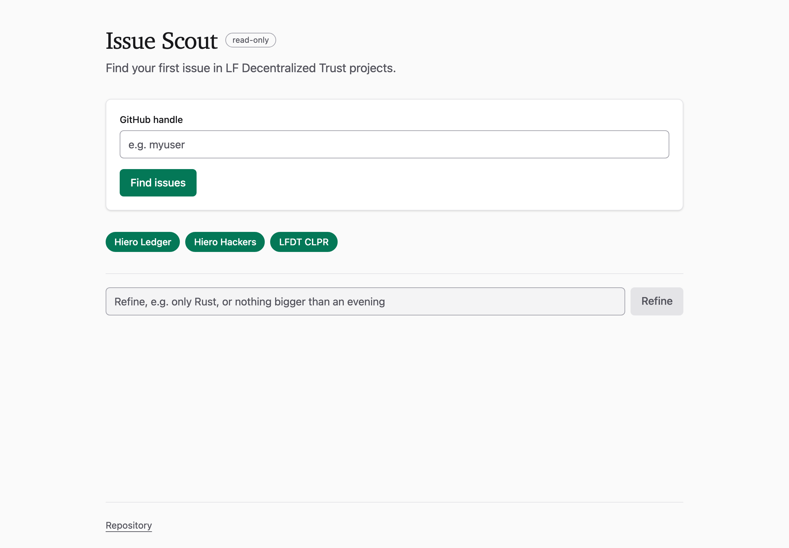
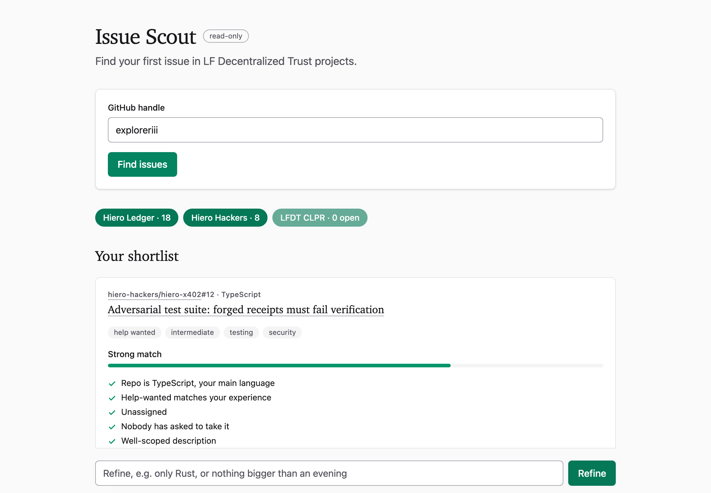
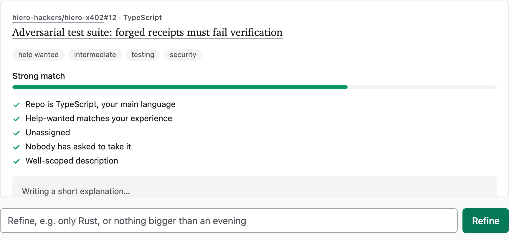
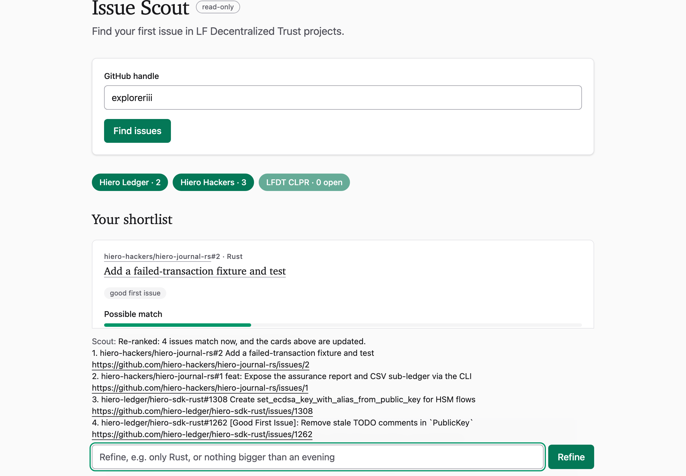

# Issue Scout

A read-only good-first-issue matcher for Hiero and LF Decentralized Trust organisations, built on Cloudflare Workers. It never writes to GitHub.

## What it does
- **Input:** a GitHub handle, or a free-text description of skills and time.
- **Output:** the top five open issues, each with a score, reasons, a model-written explanation, an effort estimate and a first step. The next five come with a note on why they were not chosen.
- **Conversation:** refine preferences (languages, time budget, tests, excluded repositories), ask about an issue, see repository context, or watch an issue.

## How to use

1. Enter your GitHub handle and press **Find issues**.

   

2. Read the shortlist. Each card shows the repository, the issue, its labels, how well it matches and why, and a short explanation of what a first pull request would look like. Organisation buttons above the list switch organisations on and off; the number is how many open candidate issues each one has.

   

   

3. Refine in plain words: "only Rust", "nothing bigger than an evening", "exclude hiero-ledger/hiero-website", "why not <issue url>", "watch 2 for 7 days". The list updates without calling GitHub again.

   

The page works on a phone.

## How it works
| Component | Role |
|---|---|
| Router | Worker: validation, rate limit, session routing |
| `IssueScoutAgent` | Agents SDK agent on a Durable Object; SQLite session state; tools |
| Sources | GitHub GraphQL and REST with ETags and a KV cache, so warm requests make no GitHub call |
| Ranker | Pure, deterministic scorer that records the reasons for each score |
| Explainer | Workers AI call that explains the ranker's output only; output is schema-validated |

## Run locally
```sh
pnpm install
pnpm -r test
cp .dev.vars.example .dev.vars
pnpm dev
```
`GITHUB_TOKEN` in `.dev.vars` is optional. Use a read-only token with public-repository scope.

## Deploy
```sh
pnpm exec wrangler kv namespace create CACHE
# paste the returned id into the CACHE binding in wrangler.jsonc
pnpm exec wrangler secret put GITHUB_TOKEN
pnpm --filter @issue-scout/ui build
pnpm exec wrangler deploy
```
A Cron Trigger (`*/30 * * * *`, set in `wrangler.jsonc`) refreshes every organisation's snapshot so searches usually hit a warm cache.

## Extend

Label aliases are seeded from the taxonomy of [hiero-hackers/analytics](https://github.com/hiero-hackers/analytics).

- **Add an organisation:** add an entry to `orgs.json` with its label aliases, then run `pnpm check-orgs`. No code change is needed.
- **Change ranking:** edit `packages/core/src/ranker.ts` and `docs/ARCHITECTURE.md` together.
- LFDT-CLPR has no labelled issues, so it yields no results until its aliases are confirmed.

## Testing
Run `pnpm -r test`. CI runs typecheck, lint, tests, the registry schema check and a dry-run deploy.

## Limits
- No GitHub writes and no user accounts.
- 30 requests per IP per hour.
- Sessions expire after 7 days.

## Documentation
See [docs/](docs/README.md): specification, requirements, architecture, decisions, ADRs.

## Licence
Apache-2.0. See [LICENSE](LICENSE).
